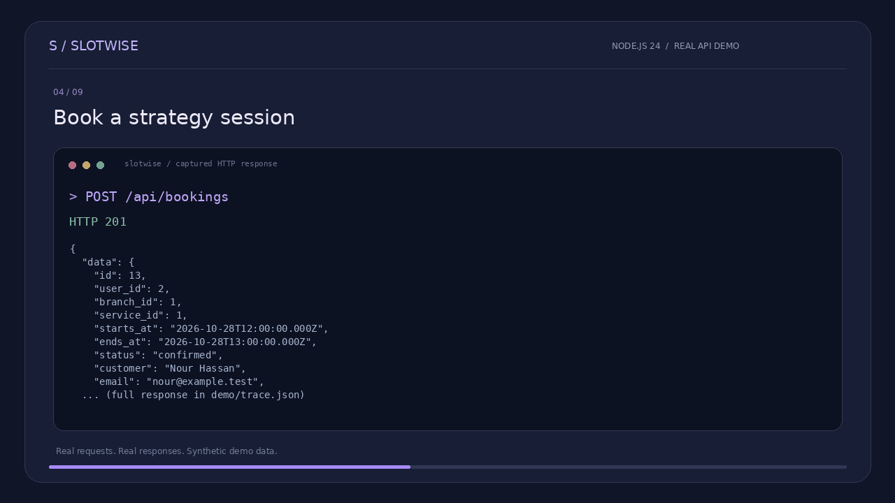

<div align="center">

# SlotWise
### Make time for what matters.

A Node.js appointment booking API with a responsive, purple-accented dashboard.

**Node.js 24 · JavaScript · SQLite · HTTP APIs · Session authentication**

[Watch the demo](./demo/slotwise-api-demo.mp4) · [API reference](./docs/API.md) · [Architecture & decisions](./docs/ARCHITECTURE.md)

</div>

---

## What it does

SlotWise brings services, branches, customers, and appointments into one workspace. Members book and cancel their own appointments; administrators see all appointments and workspace statistics.

- Member registration and login with scrypt password hashing.
- Opaque, server-side sessions; HttpOnly and SameSite=Strict cookies.
- Booking creation with server-calculated duration, ownership, and status.
- Database-trigger protection against overlapping appointments, including simultaneous requests.
- Cancellation that releases the slot; adjacent appointments are allowed.
- Branch/status filters, pagination, search within the current page, and permission-scoped statistics.
- Responsive dashboard, local-time date display, form feedback, empty states, keyboard focus styles, and confirmation dialogs.
- No external runtime packages, fonts, analytics, or API keys.

## Run locally

Requires **Node.js 24 or newer**. Node's built-in SQLite API may print an experimental warning depending on your Node version.

```bash
git clone https://github.com/0fatma5/slotwise.git
cd slotwise
npm run demo
```

Open **http://127.0.0.1:3000**. No package installation or database server is required.

The login screen offers **Try admin view** and **Try member view** in demo mode. These use public synthetic accounts ending in `@example.test` and the local-only password `DemoOnly!2026`. Demo mode refuses non-loopback hosts.

For a clean database without seeded accounts:

```bash
npm start
```

Create a member account through the UI. New registrations always receive the member role. There is intentionally no public admin-promotion endpoint. The demo administrator is seeded only for local evaluation.

## Demo video

[](./demo/slotwise-api-demo.mp4)

[**Watch the actual API walkthrough (MP4)**](./demo/slotwise-api-demo.mp4)

The video is an edited visual walkthrough of **real recorded HTTP requests and responses**, not a browser screen recording. It demonstrates booking creation, conflict rejection, member/admin access checks, cancellation, and rebooking. All data is synthetic. The matching raw responses are in [demo/trace.json](./demo/trace.json); regenerate them with `node demo/capture.mjs`.

## Verify

```bash
npm test
```

The integration suite starts the real HTTP server with an isolated, in-memory database. It exercises authorization boundaries, overlap protection, concurrency, cancellation, input validation, cookies, SQL injection, and logout. Tests never connect to an external database.

## Project layout

```text
src/database.js        schema, password hashing, seed data, overlap trigger
src/server.js          HTTP routing, authentication, validation, API handlers
public/               responsive dashboard and vanilla JavaScript client
test/api.test.js       real HTTP integration tests
docs/                 API contract and engineering decisions
demo/                 captured responses and video walkthrough
```

## Scope and tradeoffs

This is a portfolio/demo project, not a production deployment. Each branch represents **one bookable resource**; parallel appointments at the same branch are intentionally unavailable. Time ranges use half-open intervals: an appointment ending at 11:00 does not conflict with one starting at 11:00. Times are stored in UTC and displayed in the viewer's local timezone. The project does not enforce branch opening hours.

SQLite is the implemented database, chosen for a reproducible zero-setup demo. PostgreSQL, multiple resources per branch, opening-hours availability, rescheduling, reminders, payments, email verification, account recovery, and distributed rate limiting are future extensions, not shipped features. Booked value is a sum of service prices, **not collected revenue**.

Before internet-facing deployment, add HTTPS with secure cookies, deployment-specific limits and monitoring, an admin provisioning process, backup/retention policies, and browser/accessibility testing. The API has automated integration coverage; the interface has not been verified in a real browser in this environment.

## Learning notes

See [architecture decisions](./docs/ARCHITECTURE.md) for why the overlap rule belongs in the database, how authorization is scoped, and why this demo uses server-side sessions rather than JWTs. Built as a portfolio project with AI assistance; understand and adapt the implementation before presenting it in interviews.

MIT © Fatma ElZahraa Ahmed Saad
